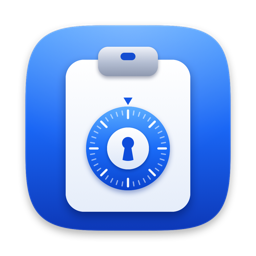
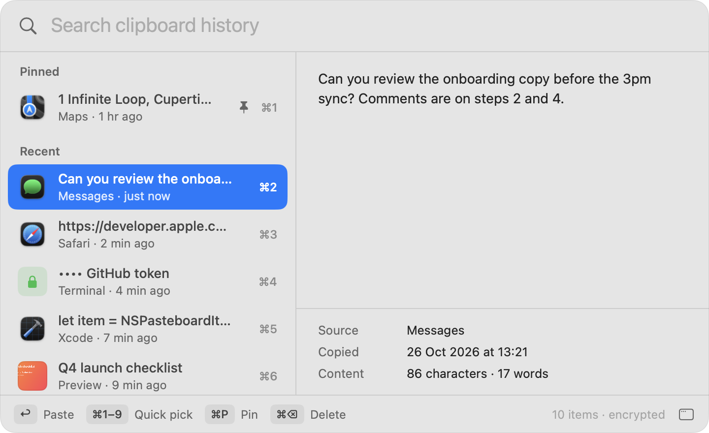
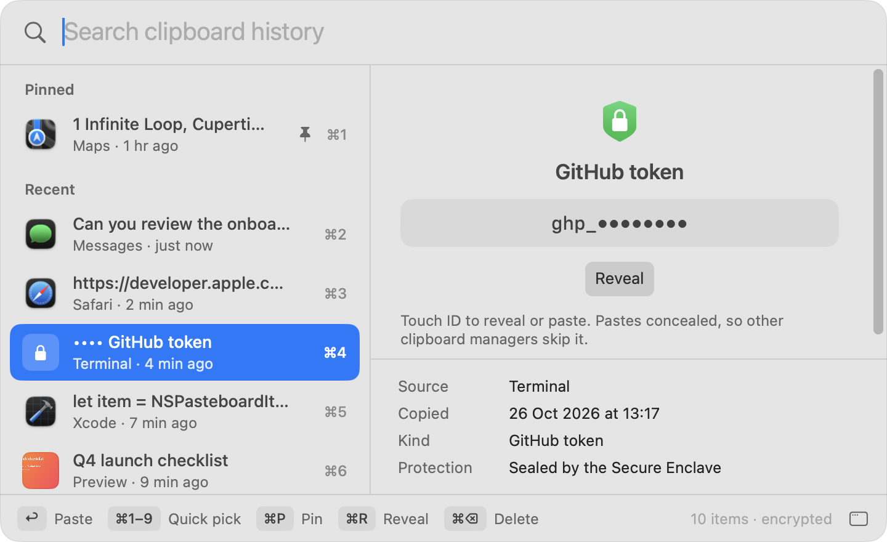
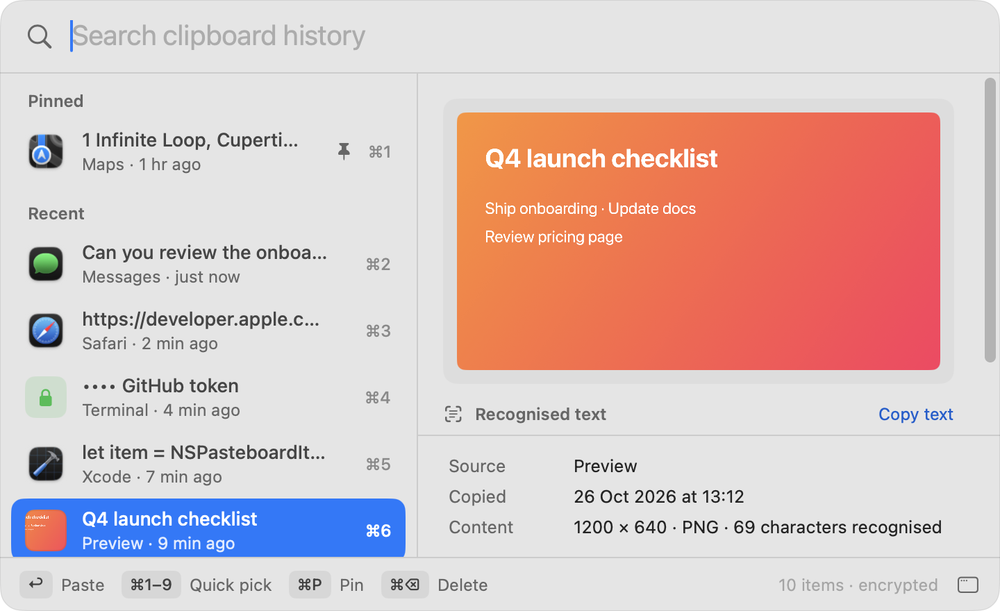
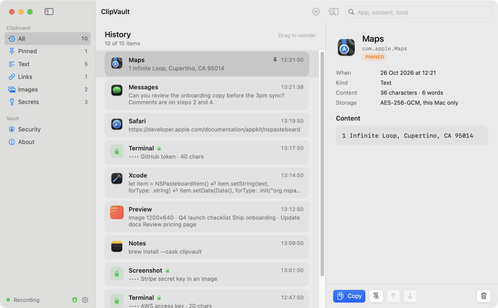

<p align="center">
  
</p>

<h1 align="center">ClipVault</h1>

<p align="center">
  Clipboard history for macOS that keeps secrets secret.<br>
  Search everything you copied, read text inside images, and never leave an API key lying around.
</p>

<p align="center">
  
  
  
  
</p>

---

ClipVault is a menu bar app that records what you copy — text, links, code and
images — into an encrypted, on-device history you can search and paste from
any app with **⌃⌘V**. It recognises passwords, API keys and tokens the moment
you copy them, hides them from other clipboard managers, wipes them from the
clipboard after a delay, and seals the copy it keeps to your Mac's **Secure
Enclave**, so it can only be opened with Touch ID or your password.

Everything happens on your Mac. ClipVault runs in the App Sandbox without a
network entitlement, so the kernel refuses any connection it might try to make.

<p align="center">
  
</p>

| Secrets stay sealed | Text read from images | History window |
| --- | --- | --- |
|  |  |  |

More in [`docs/screenshots`](docs/screenshots): dark mode, menu bar, settings and
the welcome guide. All screenshots use invented sample data.

## Highlights

| | |
| --- | --- |
| **Instant picker** | ⌃⌘V opens a Spotlight-style panel over the current app: search, preview, paste. ⌘1–9 pastes one of the first nine items. |
| **Text in images** | Screenshots and copied images are read with on-device Vision OCR as they arrive. The text is searchable and copyable. |
| **Secret detection** | 600+ published token formats across cloud, developer tools, AI, databases, payments, messaging and SaaS, plus private keys, wallets, credentials in URLs and connection strings, credential assignments and a high-entropy fallback. Secrets in screenshots are caught too. |
| **Secure Enclave seal** | Secret values are encrypted to a key that lives in the Secure Enclave and needs Touch ID or your login password for every use. |
| **Concealed clipboard** | Secrets are re-marked with the `org.nspasteboard.org` Concealed type that Raycast, Alfred, Paste, Maccy and 1Password honor, then cleared automatically. |
| **Your order** | Pin items, drag them around, or move them with ⌘↑/⌘↓ in the picker. Pinned items stay on top. |
| **Your shortcut** | Record any combination with ⌘, ⌃ or ⌥ in Settings → History. |
| **Private by design** | App Sandbox with no network access, hardened runtime, windows hidden from screen sharing, no telemetry, no account, no sync. |

## Install

ClipVault is built from source. You need macOS 14 Sonoma or later and the
Xcode Command Line Tools (Swift 5.9 or later).

```bash
git clone https://github.com/ViralOne/ClipVault.git
cd ClipVault
swift test
./Scripts/build-app.sh
open dist/ClipVault.app
```

Move `dist/ClipVault.app` to `/Applications` if you want **Open at login** to
work. On first launch a short guide walks you through the picker, a live secret
demo, notifications and your shortcut. You can replay it from Settings →
General.

### Signing

`build-app.sh` always signs with the hardened runtime and the App Sandbox
entitlements. It picks the identity in this order:

1. the `CODESIGN_IDENTITY` environment variable,
2. the first line of `.signing-identity` in the repository root (gitignored),
3. ad-hoc signing.

```bash
# Any identity from: security find-identity -v -p codesigning
CODESIGN_IDENTITY="Developer ID Application: Your Name (TEAMID)" ./Scripts/build-app.sh
```

A stable identity matters: the Keychain ties ClipVault's keys to its code
signature. An ad-hoc build gets a new signature every time, so macOS asks
before letting a rebuilt app read the existing key. Set `CODESIGN_TIMESTAMP=1`
to request a secure timestamp (needed for notarization).

## Using ClipVault

### Picker — ⌃⌘V

| Key | Action |
| --- | --- |
| type | Search text, recognised image text, app names and secret kinds |
| ↑ ↓ | Move the selection |
| ↩ | Paste into the app you were using |
| ⌘1 – ⌘9 | Paste one of the first nine items |
| ⌘P | Pin or unpin |
| ⌘↑ ⌘↓ | Move the selected item up or down your history |
| ⌘R | Reveal or hide a secret (Touch ID) |
| ⌘⌫ | Delete |
| ⌘O | Open the ClipVault window |
| esc | Clear the search, then close |

Drag the picker by any empty area to move it; it opens in the same place next
time. Settings → General → **Center on screen** puts it back.

Pasting needs the Accessibility permission. Without it, picking an item copies
it and you press ⌘V yourself.

### Menu bar

Click the menu bar icon (the app's clipboard-and-dial glyph; pause bars while
paused) for recording status, a quick search over recent items,
**Conceal clipboard now** (re-marks whatever is on the clipboard as a secret),
pause, settings and quit.

### Window

The ClipVault window has a sidebar (All, Pinned, Text, Links, Images, Secrets,
Security, About), a card list you can drag to reorder, and an inspector with
the source app, timestamps, content details and actions. Dragging is available
in **All** with an empty search, where the list maps one-to-one to your history.

### Settings

- **General** — open at login, recording, conceal sound, picker position,
  welcome guide.
- **History** — keep history, shortcut, paste into the current app, item limit,
  retention, screen-sharing protection, keep secrets, disk usage, clear history,
  apps to ignore.
- **Protection** — conceal secrets, notifications, auto-clear delay, apps whose
  copies are always secret (Passwords and Keychain Access by default).
- **Privacy** — live status of encryption, the Secure Enclave seal, the
  sandbox, data location, and the danger zone.

`clipvault://picker`, `clipvault://main` and `clipvault://welcome` open those
views from Shortcuts, Raycast or a terminal. URLs never carry clipboard data.

## Security model

ClipVault layers its protections so that no single file, key or permission is
enough to read a secret.

```text
             ┌───────────────────────── history.enc / images/*.bin ─────────────────────────┐
 plain item  │ AES-256-GCM with the vault key (login Keychain, device-only, this app only) │
             └──────────────────────────────────────────────────────────────────────────────┘
             ┌────────────────────────────── same files, inner layer ───────────────────────┐
 secret      │ ECIES: P-256 ECDH with a Secure Enclave key → HKDF-SHA256 → AES-256-GCM     │
             │ The private key never leaves the Secure Enclave and needs user presence.    │
             └──────────────────────────────────────────────────────────────────────────────┘
```

**When you copy a secret**

1. The clipboard is polled every 0.25 s (no Input Monitoring permission needed).
2. A match is rewritten to the pasteboard with the Concealed marker, so
   well-behaved clipboard managers skip it, and an auto-clear is scheduled.
3. If you keep secrets in history, the value is sealed to the Secure Enclave
   public key. Only a masked preview (`ghp_••••••••`, or `••••••••` for values
   without a published prefix), the kind, the length and a keyed HMAC digest
   for de-duplication are kept next to it.
4. Revealing, copying or pasting it asks for Touch ID or your password. The
   authenticated context is handed to the Secure Enclave, which performs the
   key agreement; the plaintext lives in memory only while it is shown (30 s)
   or being pasted, and the paste is concealed and auto-cleared again.
5. An unlock covers only that one secret, for up to 60 seconds, so revealing
   and then pasting it asks once. Any other secret asks again. Sleep, screen
   lock or the screen saver end the unlock and hide anything revealed.
6. A secret is pasted only into the app you were using, and only once that app
   is in front; otherwise it is just copied. Quitting ClipVault clears a secret
   that is still waiting to be auto-cleared.

Images whose recognised text is a secret get the same treatment: the OCR text
and the image bytes are both sealed, and the preview stays locked.

**What this protects against**

| Threat | Result |
| --- | --- |
| Someone copies your history files or a backup | Unreadable: the vault key is a device-only Keychain item and secrets also need the Secure Enclave. |
| Another app reads ClipVault's files | macOS asks before granting access to the app's sandbox container, and the files are encrypted. |
| Another app asks the Keychain for the vault key | macOS prompts — the item trusts only ClipVault's code signature. Secrets stay sealed even if you approve. |
| Malware with your login password | It can approve Keychain prompts and read ordinary history. Each secret still needs a separate user-presence check in the Secure Enclave. |
| Code injection or debugging | Blocked by the hardened runtime (no `get-task-allow`, no library injection). |
| Data leaving the Mac | The App Sandbox has no network entitlement; there is no network code. |
| Screen sharing, screenshots and recordings | ClipVault's windows are excluded from capture (on by default). |
| Other clipboard managers keeping your secret | Concealed marker plus auto-clear. |

**What it does not protect against**

- **The clipboard race.** An app that reads the pasteboard in the few
  milliseconds before ClipVault conceals a value can still see it. No polling
  clipboard tool can close that window.
- **A compromised system.** Root or kernel access, or malware that can drive
  Touch ID prompts you approve, defeats any user-space app.
- **Missed detections.** Detection is pattern-based. Unusual secrets may not be
  recognised; use **Conceal clipboard now** or add the source app to
  **Always conceal**.
- **Ordinary history** is protected by the vault key, not by Touch ID. Turn off
  **Keep clipboard history** or ignore apps you don't want recorded.
- **Macs without a Secure Enclave** (Intel Macs before the T2 chip) fall back to
  the vault key for secrets. Settings → Privacy shows which mode is active.

Resetting the store (Settings → Privacy) deletes the history and creates a new
Secure Enclave key; secrets sealed to the old key cannot be recovered, by design.

## Data

| Data | Location |
| --- | --- |
| History | `~/Library/Containers/app.clipvault.ClipVault/Data/Library/Application Support/ClipVault/history.enc` |
| Images | `…/ClipVault/images/<uuid>.bin` |
| Vault key | login Keychain, service `app.clipvault.ClipVault`, account `vault-key` |
| Secure Enclave key handle | login Keychain, account `secure-enclave-secret-key` (an opaque, device-bound reference) |
| Preferences | `~/Library/Containers/app.clipvault.ClipVault/Data/Library/Preferences/` |

Directories are created `0700` and files written `0600`. History older than
0.3 lived outside the sandbox in `~/Library/Application Support/ClipVault` and
is not migrated; delete that folder and the `history-key` Keychain item if you
used an earlier build.

## OCR

Images are normalised (longest edge 1600 px, PNG or JPEG under ~3.5 MB),
encrypted and added to history immediately. Vision then reads the original
image on device with automatic language detection and language correction; the
item updates when recognition finishes. Printed text works well; handwriting,
tiny or low-contrast text may be missed.

## Project layout

```text
Sources/
  ClipVaultKit/             Testable core
    HistoryItem.swift       Model, display rules and search filter
    SecretDetector.swift    Matching, assignments, entropy, masking
    SecretPatterns*.swift   600+ formats: core, cloud, developer, AI/data, SaaS, keys
    SecretEnvelope.swift    ECIES envelope and keyed digest
    VaultCrypto.swift       Vault key and Keychain access
    OCRService.swift        Vision text recognition
  ClipVault/                The app (AppKit + SwiftUI)
    AppServices.swift       Composition root, windows, URL routes
    ClipboardMonitor.swift  Polling, classification, concealment, OCR
    HistoryStore.swift      Encrypted persistence, sealing, ordering
    SecretVault.swift       Secure Enclave key and Touch ID
    ImageStore.swift        Encrypted image blobs
    PickerController.swift  Picker panel and keyboard handling
    PasteService.swift      Unseal, copy, paste, HUD
    HotKeySettings.swift    Shortcut model and recorder
    UI/                     Picker, window, menu bar, settings, onboarding
Tests/ClipVaultKitTests/    Detector, envelope, model, filter and OCR tests
Scripts/
  build-app.sh              Build, bundle and sign dist/ClipVault.app
  make-icon.sh/.swift       Render the app icon with Core Graphics
Support/                    Info.plist, entitlements, AppIcon.icns
```

## Development

```bash
swift build            # debug build of the app and the kit
swift test             # 50 tests: every secret format has a sample, plus a false-positive corpus
./Scripts/make-icon.sh # regenerate Support/AppIcon.icns
```

There is no Xcode project: the app is a SwiftPM executable wrapped into an
`.app` bundle by `build-app.sh`.

## License

No license has been chosen yet. The source is published for review and personal
use; contact the repository owner before redistributing.
